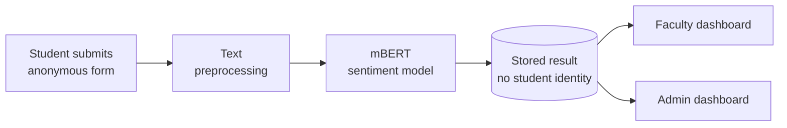

<div align="center">


# EchoSent

**Student Feedback & Sentiment Analysis for Asiatech**

Anonymous student evaluations, analyzed with multilingual BERT (mBERT).

[](https://echosent.duckdns.org)


[Live Site](https://echosent.duckdns.org) · [Features](#-features) · [Getting Started](#-getting-started) · [Roadmap](#-roadmap)

</div>

---

## 📖 About

EchoSent is a web-based evaluation system developed as a research project. Students submit **anonymous** evaluations across four categories: **faculty, staff, facilities, and payments**. The written comments are classified by sentiment using a fine-tuned **mBERT** model, so administrators and faculty can understand feedback at a glance instead of reading every response.

Students can give honest feedback without fear of being identified, and the school gets clear, summarized insight into how teaching, services, and facilities are being received.

## ✨ Features

- 📝 **Anonymous evaluation form**: submissions are not tied to a student's identity
- 🤖 **Automated sentiment analysis**: comments are classified by a fine-tuned mBERT model
- 🌐 **Multilingual support**: mBERT handles multiple languages, including mixed-language comments
- 🗂️ **Four evaluation categories**: faculty, staff, facilities, and payments
- 🎓 **Course and year-level tagging**: results can be broken down by program (BSA, BSBA, BSHM/AHM, BSTM, BSIT/AIT, BSCS, BSCPE, BSCRIM, BSED) and year level
- 📮 **Voice in a Box**: a separate anonymous drop box for general feedback about the overall school experience, with no student ID, login, or name captured
- 📢 **Action Bulletin**: a public page showing the actions taken in response to student feedback
- 📊 **Dashboards**: sentiment charts and summaries for admins and faculty
- 🔑 **Password reset**: email-based reset flow for accounts

## 👥 User Roles

| Role | Access |
| :--- | :--- |
| **Admin** | Overview, Responses, Analytics, Model Results, and Action Updates. Views evaluation result charts across all categories (faculty, staff, facilities, and payments). Account management is not yet available (see [Roadmap](#-roadmap)). |
| **Faculty** | Views the evaluation analytics and sentiment results for their own classes only. |
| **Student** | Submits the evaluation form anonymously. No identifying information is attached to the feedback. |

## ⚙️ How It Works



1. A student submits an evaluation (ratings and written comments) anonymously.
2. The comment text is cleaned and tokenized.
3. The mBERT model predicts the sentiment of each comment.
4. The result is stored without any link to the student's identity.
5. Faculty see results for their own classes, and admins see charts for every category.

## 🧠 Sentiment Analysis Model

| Item | Details |
| :--- | :--- |
| **Base model** | `bert-base-multilingual-cased` (mBERT) |
| **Task** | Sentiment classification of student feedback comments |
| **Labels** | Positive / Neutral / Negative *(edit to match your labels)* |
| **Training data** | *(Describe your dataset: source, size, language(s))* |
| **Fine-tuning** | *(Epochs, batch size, learning rate, framework)* |
| **Accuracy** | `__%` |
| **Precision / Recall / F1** | `__%` / `__%` / `__%` |


## 🛠️ Tech Stack

| Area | Technology |
| :--- | :--- |
| Frontend | HTML/CSS/JS, React* |
| Backend | Flask, Django,FastAPI, PHP, Node.js |
| Machine Learning | mBERT, Hugging Face Transformers, PyTorch / TensorFlow |
| Database | PostgreSQL |
| Hosting | Duck DNS |

## 🚀 Getting Started

### Prerequisites

- Python 3.9 or later
- pip
- Git
- A database server *(e.g., MySQL)*

### Installation

```bash
# 1. Clone the repository
git clone https://github.com/your-username/echosent.git
cd echosent

# 2. Create and activate a virtual environment
python -m venv venv
source venv/bin/activate      # On Windows: venv\Scripts\activate

# 3. Install dependencies
pip install -r requirements.txt

# 4. Set up environment variables
cp .env.example .env

# 5. Set up the database (adjust to your framework)
python manage.py migrate

# 6. Run the application
python app.py
```

Then open <http://localhost:5000> in your browser.

> [!IMPORTANT]
> Place the fine-tuned mBERT model files in the `model/` folder before running the app, or download them from *(link to your model)*.

### Configuration

Create a `.env` file in the project root:

```env
SECRET_KEY=your_secret_key_here
DATABASE_URL=your_database_url_here
MODEL_PATH=./model
DEBUG=False
```

> [!WARNING]
> Never commit your `.env` file or share secret keys publicly.

### Creating the first admin account

```bash
# Replace with the command or script your system uses
python create_admin.py
```

Change any default password immediately after the first login.

## 📁 Project Structure

```text
echosent/
├── app/
│   ├── routes/          # Admin, faculty, and student routes
│   ├── templates/       # HTML pages (dashboards, evaluation form)
│   └── static/          # CSS, JavaScript, images
├── model/               # Fine-tuned mBERT model files
├── notebooks/           # Training and evaluation notebooks
├── data/                # Dataset (if shareable)
├── .env.example         # Example environment variables
├── requirements.txt
└── README.md
```

*Update this tree to match your actual folders.*

## 🔒 Privacy and Anonymity

- Evaluation submissions are **not linked to student accounts or personal identifiers**.
- **Voice in a Box** messages capture no student ID, login, or name.
- Faculty can only see feedback for **their own** classes.
- Only administrators can view system-wide results across all categories.
- Data is used **for research and evaluation purposes only**.

## 🗺️ Roadmap

- [x] Anonymous student evaluation form
- [x] mBERT sentiment analysis of comments
- [x] Voice in a Box anonymous drop box
- [x] Public Action Bulletin
- [x] Faculty dashboard
- [x] Admin dashboard with result charts for faculty, staff, facilities, and payments
- [ ] Admin account management (create, edit, and deactivate faculty and admin accounts)
- [ ] Evaluation period management
- [ ] Exportable reports (PDF / CSV)

## 🎓 Research Team

**Institution:** Asia Techcnological School of Science and Arts

| Name | Role |
| :--- | :--- |
| Justin Rey Q. Agapito | Lead Developer |
| Rosemay N. Lorena | Machine Learning |
| Queenie Mae C. Libres | Documentation |
| Camille S. Camaclang | Research Adviser |

## 📄 License

This project was developed for academic research purposes. All rights reserved.

## 📬 Contact

- **Email:** your-email@example.com
- **GitHub:** [@rowseiyyyy](https://github.com/rowseiyyyy)
- **Website:** [echosent.duckdns.org](https://echosent.duckdns.org)

---

<div align="center">
  <sub>EchoSent · Where every student voice is heard and every feedback is understood</sub>
</div>
